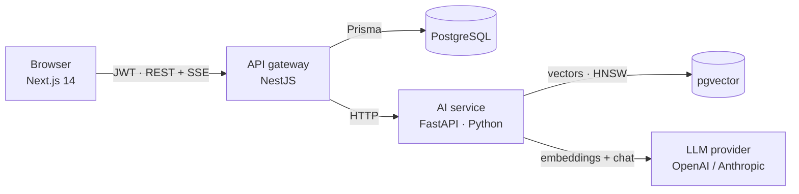

# AI Knowledge Copilot

**Chat with your company documents.** Upload PDFs, Markdown or text files and ask questions in plain language. Every answer is grounded in your own sources and shows numbered citations you can check, and the assistant says "I don't know" instead of guessing.


## Why this project

Retrieval-Augmented Generation (RAG) is the most common way companies put LLMs to work on internal knowledge. This repo is a complete, production-shaped implementation rather than a notebook demo:

- **Multi-tenant by design:** every user gets an isolated workspace, enforced at the database query level.
- **Streaming answers** over Server-Sent Events, end to end from the model to the browser.
- **Pluggable providers:** OpenAI or Anthropic for generation, OpenAI for embeddings, plus offline providers so the whole stack runs and is tested **without any API key**.
- **Tested and CI-checked:** Python and TypeScript unit and API tests, linting and builds on every push.

## Architecture



| Component | Responsibility |
|---|---|
| `apps/web` | Next.js App Router UI: auth, drag-and-drop upload, streaming chat with expandable citations |
| `apps/api` | NestJS gateway: JWT auth, rate limiting, file upload and text extraction (PDF/TXT/MD), chat history, SSE proxy, Swagger docs |
| `services/ai` | FastAPI service: structure-aware chunking, embeddings, pgvector search, grounded prompting, token streaming |

### How a question is answered

1. The question is embedded with the same model used for the documents.
2. pgvector returns the top-k nearest chunks **from the caller's workspace only** (cosine distance, HNSW index).
3. Chunks below a relevance threshold are dropped. If nothing is left, the service answers "I couldn't find anything" without calling the LLM, which saves cost and avoids hallucination.
4. The remaining chunks are numbered and sent to the LLM with a strict "answer only from sources, cite as [n]" system prompt.
5. Sources are streamed first, then tokens, so the UI can show citations while the answer is still being written.

## Quick start

```bash
cp .env.example .env          # add OPENAI_API_KEY, or use the offline providers
docker compose up --build
```

- Web UI: http://localhost:3000
- API docs (Swagger): http://localhost:4000/docs

**No API key?** Set `LLM_PROVIDER=echo`, `EMBEDDING_PROVIDER=hash` and `EMBEDDING_DIM=384` in `.env`. Retrieval still works on keyword overlap, and the echo model returns the best-matching source.

## Running tests

```bash
# AI service
cd services/ai && pip install -r requirements-dev.txt && pytest

# API
cd apps/api && npm ci && npx prisma generate && npm test
```

## API overview

| Method | Path | Description |
|---|---|---|
| `POST` | `/api/auth/register` | Create account and private workspace |
| `POST` | `/api/auth/login` | Get a JWT |
| `GET` | `/api/documents` | List documents and indexing status |
| `POST` | `/api/documents` | Upload a file (multipart, max 10 MB) |
| `DELETE` | `/api/documents/:id` | Delete a document and its vectors |
| `POST` | `/api/chat/ask` | Ask a question (SSE stream: `sources` → `token`* → `done`) |
| `GET` | `/api/chat/history` | Recent conversation |

## Design decisions

- **Separate Python AI service.** The AI ecosystem lives in Python, while the product API benefits from NestJS's structure. A narrow HTTP contract keeps them independently deployable and scalable.
- **pgvector instead of a dedicated vector DB.** One database to operate, transactional deletes, and an HNSW index is fast enough for millions of chunks.
- **Indexing happens in the background.** Upload returns immediately with status `PROCESSING`; the UI polls until `READY` or `FAILED`.
- **Re-ingesting replaces.** Old chunks of a document are deleted before new ones are written, so stale content never leaks into answers.

## Roadmap

- [ ] Hybrid search (BM25 + vectors) with reranking
- [ ] Retrieval evaluation set and answer-faithfulness metrics in CI
- [ ] Background job queue (BullMQ) for large documents
- [ ] Team workspaces with role-based access

## License

MIT © Quy Nguyen
